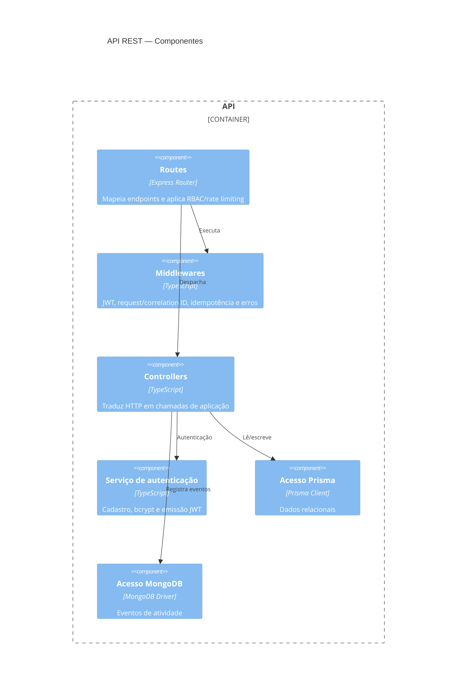

# C4 — Diagrama de Componentes

A divisão em camadas mantém transporte HTTP separado das regras e do acesso a dados. Middlewares centralizam os controles transversais; controllers validam contratos; Prisma/Mongo concentram persistência.
