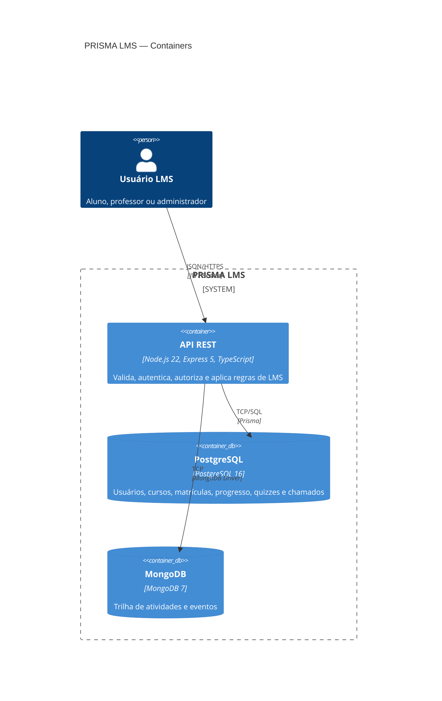

# C4 — Diagrama de Containers

PostgreSQL foi escolhido para integridade referencial, unicidade, transações e dados fortemente relacionados. MongoDB é usado para atividade append-oriented e consultas de trilha, permitindo evoluir eventos sem acoplamento ao modelo relacional.
